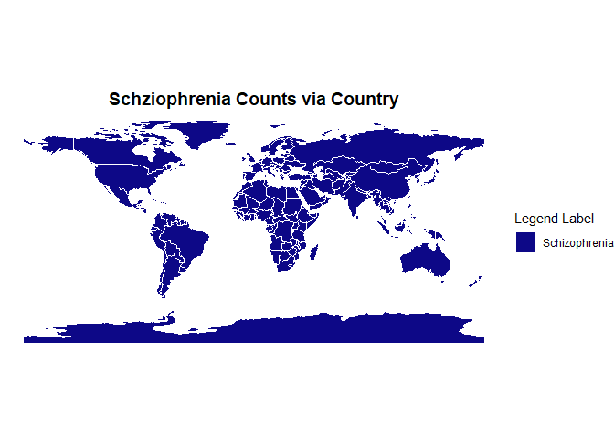
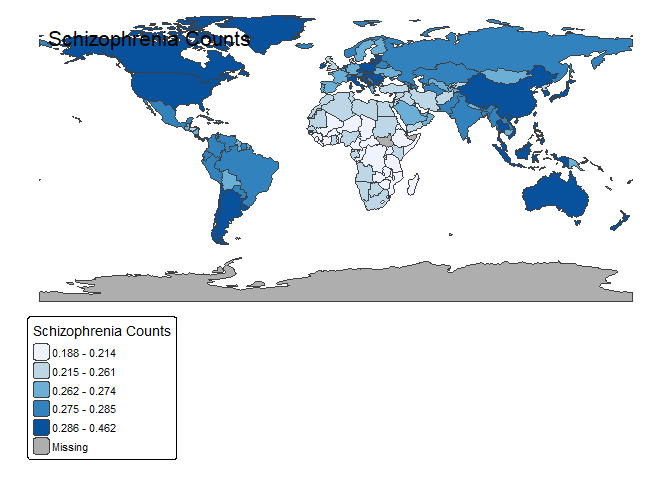

Typology-And-Mental-Health
================
Siena Rivera

# Myers-Briggs Type Indicator (MBTI), Countries, and Mental Health Disorders

## Overview

Throughout the past decade, Myers-Briggs Type Indicator (MBTI) has been
notorious for personality assessments and self-discovery. We wanted to
look further into this topic, and the connection between MBTI and Mental
Health Disorders. MBTI is hypothesized to have types that are more
correlated with different disorders. That is what we will look further
into. Although they are known as pseudosciences, these forms of
self-acknowledgement are great for human growth and development.

## Research Question

When it comes to MBTI, what is the possible connection between Mental
Disorders and the 16 MBTI types?

## Background and Prior Work

Jungian Theory and Myers-Briggs Typology Indicator

When it comes to MBTI, they are considered to be the most known forms of
typology. BIG 5 or OCEAN is also considered to be noteworthy and
incredibly useful. However, it does not seem to be as popular as the
prior two considered. I’d like to preface this by explaining exactly
what MBTI is and how it differs from the original Jungian functions.

Carl Jung created 8 Cognitive Functions: Extraverted/Introverted
Intuition, Sensing, Feelings and Thinking (Ne,Ni,Se,Si,Fe,Fi,Te,Ti).
Years later, Myers and Briggs took his knowledge and ideas and created
16 personalities from the original idea. This was later known as MBTI
types. MBTI types being made up of 8 phrases: Extravert/Introvert,
Sensing/Intuition, Feeling/Thinking, and Judging/Perceiving. The 8
letters became 4 choices, and you are labeled into one of 16 boxes made
up of the different letter scheme.

According to TheMyersBriggs.com, The Myers-Briggs Type Indicator®
(MBTI®) assessment is one of the world’s most popular personality
tools—because it works. Used by more than 88 percent of Fortune 500
companies in 115 countries, and available in 29 languages, it has become
the go-to framework for people development globally. With more than 70
years of science-based, research-based insight, the MBTI assessment is a
robust tool for self-awareness and improvement. It provides positive
language for understanding and valuing individual differences. With
practical insight that’s easy to understand and implement, the MBTI
assessment has helped thousands of organizations and millions of people
around the world improve how they communicate, learn, and work1.

Several other studies have looked further into the idea of patients with
several mental health disorders and their correspondent typology type.
One study in specifics looked further into patients with suicidal
tendencies and thoughts2. In addition, there has been more reasearch
into specific mental health disorders and the connection to different
letters in MBTI3.

Although there are many hypotheses and assumptions in regards to
typology and mental health disorders, there is no clear evidentiary
support. While many psychologists, including Carl Jung himself, state
that there are no strong connection between the two, it is something
that could be considered useful to look further into4

1 The Myers Briggs Website 2 Relationship of Myers Briggs type indicator
personality characteristics to suicidality in affective disorder
patients 3 MBTI Personality Profiles in Unipolar Depressed Patients 4
The Dark Side of the MBTI

## Hypothesis

Our hypothesis is that Mental Health and Typology have some slight
connection and causation. By that we ask if there is a correlation
between Mental Health disorders and Typology types such as MBTI. We
acknowledge that there may be some confounding variable such as
Socioeconomic Status, Education, and Physical Health Status. There is
also the reality that there is no strong connection between
Psuedosciences and a lack of knowledge and evidentiary support.

## Dataset(s) Used

### Main Datasets

Mental Health Name: mental-illnesses-prevalence.csv Link to the Dataset
Description: Mental health is an essential part of people’s lives and
society. Poor mental health affects our well-being, our ability to work,
and our relationships with friends, family, and community. Mental Health
Dataset Name: mental-and-substance-use-as-share-of-disease.csv Link to
the Dataset Description: Mental health includes our emotional,
psychological, and social well-being. It affects how we think, feel, and
act. It also helps determine how we handle stress, relate to others, and
make healthy choices. 1. Mental health is important at every stage of
life, from childhood and adolescence through adulthood. MBTI-TYPES Data
Name: countries.csv \| types.csv Link to the Dataset Description:
Includes world stats, infos about each type and more crazy stuff…

## Setup:

``` r
# First let's grab the required and necessary Libraries!

library(rmarkdown)
library(tidyverse)
```

    ## ── Attaching core tidyverse packages ──────────────────────── tidyverse 2.0.0 ──
    ## ✔ dplyr     1.2.0     ✔ readr     2.2.0
    ## ✔ forcats   1.0.1     ✔ stringr   1.6.0
    ## ✔ ggplot2   4.0.2     ✔ tibble    3.3.1
    ## ✔ lubridate 1.9.5     ✔ tidyr     1.3.2
    ## ✔ purrr     1.2.1     
    ## ── Conflicts ────────────────────────────────────────── tidyverse_conflicts() ──
    ## ✖ dplyr::filter() masks stats::filter()
    ## ✖ dplyr::lag()    masks stats::lag()
    ## ℹ Use the conflicted package (<http://conflicted.r-lib.org/>) to force all conflicts to become errors

``` r
library(questionr)
library(ggplot2)
library(reshape2)
```

    ## 
    ## Attaching package: 'reshape2'
    ## 
    ## The following object is masked from 'package:tidyr':
    ## 
    ##     smiths

``` r
library(scales)
```

    ## 
    ## Attaching package: 'scales'
    ## 
    ## The following object is masked from 'package:purrr':
    ## 
    ##     discard
    ## 
    ## The following object is masked from 'package:readr':
    ## 
    ##     col_factor

``` r
library(car)
```

    ## Warning: package 'car' was built under R version 4.5.3

    ## Loading required package: carData

    ## Warning: package 'carData' was built under R version 4.5.3

    ## 
    ## Attaching package: 'car'
    ## 
    ## The following object is masked from 'package:dplyr':
    ## 
    ##     recode
    ## 
    ## The following object is masked from 'package:purrr':
    ## 
    ##     some

``` r
library(broom)
```

    ## Warning: package 'broom' was built under R version 4.5.3

``` r
library(tidyr)
library(effects)
```

    ## Warning: package 'effects' was built under R version 4.5.3

    ## Registered S3 method overwritten by 'lme4':
    ##   method           from
    ##   na.action.merMod car 
    ## lattice theme set by effectsTheme()
    ## See ?effectsTheme for details.

``` r
library(logistf)
```

    ## Warning: package 'logistf' was built under R version 4.5.3

``` r
library(MASS)
```

    ## 
    ## Attaching package: 'MASS'
    ## 
    ## The following object is masked from 'package:dplyr':
    ## 
    ##     select

``` r
library(ResourceSelection)
```

    ## Warning: package 'ResourceSelection' was built under R version 4.5.3

    ## ResourceSelection 0.3-6   2023-06-27

``` r
library(pROC)
```

    ## Warning: package 'pROC' was built under R version 4.5.3

    ## Type 'citation("pROC")' for a citation.
    ## 
    ## Attaching package: 'pROC'
    ## 
    ## The following objects are masked from 'package:stats':
    ## 
    ##     cov, smooth, var

``` r
library(readr)
library(ggmap)
```

    ## Warning: package 'ggmap' was built under R version 4.5.3

    ## ℹ Google's Terms of Service: <https://mapsplatform.google.com>
    ##   Stadia Maps' Terms of Service: <https://stadiamaps.com/terms-of-service>
    ##   OpenStreetMap's Tile Usage Policy: <https://operations.osmfoundation.org/policies/tiles>
    ## ℹ Please cite ggmap if you use it! Use `citation("ggmap")` for details.

``` r
library(dplyr)  
library(sf)
```

    ## Warning: package 'sf' was built under R version 4.5.3

    ## Linking to GEOS 3.14.1, GDAL 3.12.1, PROJ 9.7.1; sf_use_s2() is TRUE

``` r
library(scales)
library(tmap)
```

    ## Warning: package 'tmap' was built under R version 4.5.3

    ## Registered S3 method overwritten by 'stars':
    ##   method                  from
    ##   st_interpolate_aw.stars sf

## Data Cleaning

### Table of Contents

- Countries Databases for Illustration and Correlations
- MBTI Personality Databases
- Mental Health and Disorders Databases Combining Data: The datasets we
  have chosen will be combined and subsequently analyzed to give a
  measure of the overall relationship between MBTI and Mental Health.
  From there we want to look further into each Country around the world
  and the analysis that will follow from there.

## MBTI Personality Databases

### I. MBTI Types by Country

First we will focus on the MBTI Types by each Country around the globe.
We will compile the datasets from MBTI-Types Data and others to see
which of the 16 types is most prevalent in each individual Country.

``` r
#importing data
mbti_df <- read_csv("datasets/Personality-Databases/countries.csv")
```

    ## Rows: 158 Columns: 33
    ## ── Column specification ────────────────────────────────────────────────────────
    ## Delimiter: ","
    ## chr  (1): Country
    ## dbl (32): ESTJ-A, ESFJ-A, INFP-T, ESFJ-T, ENFP-T, ENFP-A, ESTJ-T, ISFJ-T, EN...
    ## 
    ## ℹ Use `spec()` to retrieve the full column specification for this data.
    ## ℹ Specify the column types or set `show_col_types = FALSE` to quiet this message.

``` r
head(df, 4)
```

    ##                                            
    ## 1 function (x, df1, df2, ncp, log = FALSE) 
    ## 2 {                                        
    ## 3     if (missing(ncp))                    
    ## 4         .Call(C_df, x, df1, df2, log)

``` r
#combine columns to sum up MBTI -A and -T (since I don't believe there's a significant difference)

mbti_types <- c("INTJ", "INFJ", "INFP", "INTP", "ISTJ", "ISFJ", "ISFP", "ISTP",
                "ENTJ", "ENFJ", "ENFP", "ENTP", "ESTJ", "ESFJ", "ESFP", "ESTP")

for (type in mbti_types) {
  col_A <- paste0(type, "-A")
  col_T <- paste0(type, "-T")
  
  # Create the new combined column by summing them
  mbti_df[[type]] <- mbti_df[[col_A]] + mbti_df[[col_T]]
}

cols_to_drop <- c(paste0(mbti_types, "-A"), paste0(mbti_types, "-T"))
mbti_df <- subset(mbti_df, select = -which(names(mbti_df) %in% cols_to_drop))
write.csv(mbti_df, "datasets/Personality-Databases/mbti_combined.csv", row.names = FALSE)

head(mbti_df,4)
```

    ## # A tibble: 4 × 17
    ##   Country    INTJ   INFJ   INFP   INTP   ISTJ   ISFJ   ISFP   ISTP   ENTJ   ENFJ
    ##   <chr>     <dbl>  <dbl>  <dbl>  <dbl>  <dbl>  <dbl>  <dbl>  <dbl>  <dbl>  <dbl>
    ## 1 Afghani… 0.0431 0.0463 0.0686 0.0549 0.0629 0.061  0.046  0.0434 0.0511 0.0562
    ## 2 Albania  0.0604 0.0748 0.104  0.0754 0.0418 0.0449 0.0334 0.0233 0.0686 0.0775
    ## 3 Algeria  0.0896 0.08   0.156  0.141  0.032  0.0337 0.0377 0.033  0.0535 0.0556
    ## 4 Andorra  0.0326 0.0791 0.167  0.0512 0.0279 0.0465 0.0419 0.0186 0.0465 0.116 
    ## # ℹ 6 more variables: ENFP <dbl>, ENTP <dbl>, ESTJ <dbl>, ESFJ <dbl>,
    ## #   ESFP <dbl>, ESTP <dbl>

## Mental Disorders Databases

### I. Mental Disorders by Country

Next we will focus on the percentages of Mental Disorder Prevalence by
each Country around the globe. We will compile the datasets from Mental
Health Data and others to see which of the different disorders chosen
are most prevalent in each individual Country.

``` r
#importing data
df_mental <- read.csv('datasets/MentalHealth-2023/mental-illnesses-prevalence.csv')
head(df_mental, 4)
```

    ##        Entity Code Year
    ## 1 Afghanistan  AFG 1990
    ## 2 Afghanistan  AFG 1991
    ## 3 Afghanistan  AFG 1992
    ## 4 Afghanistan  AFG 1993
    ##   Schizophrenia.disorders..share.of.population....Sex..Both...Age..Age.standardized
    ## 1                                                                         0.2232058
    ## 2                                                                         0.2224538
    ## 3                                                                         0.2217512
    ## 4                                                                         0.2209872
    ##   Depressive.disorders..share.of.population....Sex..Both...Age..Age.standardized
    ## 1                                                                       4.996118
    ## 2                                                                       4.989290
    ## 3                                                                       4.981346
    ## 4                                                                       4.976958
    ##   Anxiety.disorders..share.of.population....Sex..Both...Age..Age.standardized
    ## 1                                                                    4.713314
    ## 2                                                                    4.702100
    ## 3                                                                    4.683743
    ## 4                                                                    4.673549
    ##   Bipolar.disorders..share.of.population....Sex..Both...Age..Age.standardized
    ## 1                                                                   0.7030231
    ## 2                                                                   0.7020688
    ## 3                                                                   0.7007920
    ## 4                                                                   0.7000869
    ##   Eating.disorders..share.of.population....Sex..Both...Age..Age.standardized
    ## 1                                                                  0.1277000
    ## 2                                                                  0.1232559
    ## 3                                                                  0.1188441
    ## 4                                                                  0.1150889

``` r
# rename columns
names(df_mental) <- c("ADMIN", "ADM0_A3", "Year", "Schizophrenia", "Depression", "Anxiety", "Bipolar", "Eating Disorders")

country_averages <- df_mental %>%
  group_by(ADMIN, ADM0_A3) %>%
  summarise(
    Schizophrenia    = mean(Schizophrenia, na.rm = TRUE),
    Depression       = mean(Depression, na.rm = TRUE),
    Anxiety          = mean(Anxiety, na.rm = TRUE),
    Bipolar          = mean(Bipolar, na.rm = TRUE),
    Eating_Disorders = mean(`Eating Disorders`, na.rm = TRUE), # Backticks handle spaces
    .groups = "drop"
  )

head(df_mental, 4)
```

    ##         ADMIN ADM0_A3 Year Schizophrenia Depression  Anxiety   Bipolar
    ## 1 Afghanistan     AFG 1990     0.2232058   4.996118 4.713314 0.7030231
    ## 2 Afghanistan     AFG 1991     0.2224538   4.989290 4.702100 0.7020688
    ## 3 Afghanistan     AFG 1992     0.2217512   4.981346 4.683743 0.7007920
    ## 4 Afghanistan     AFG 1993     0.2209872   4.976958 4.673549 0.7000869
    ##   Eating Disorders
    ## 1        0.1277000
    ## 2        0.1232559
    ## 3        0.1188441
    ## 4        0.1150889

``` r
# shapefile setup
map_boundaries <- st_read("shapefiles/ne_110m_admin_0_countries/ne_110m_admin_0_countries.shp")
```

    ## Reading layer `ne_110m_admin_0_countries' from data source 
    ##   `C:\Users\siena\Documents\GitHub\TypologyAndMentalHealth\shapefiles\ne_110m_admin_0_countries\ne_110m_admin_0_countries.shp' 
    ##   using driver `ESRI Shapefile'
    ## Simple feature collection with 177 features and 168 fields
    ## Geometry type: MULTIPOLYGON
    ## Dimension:     XY
    ## Bounding box:  xmin: -180 ymin: -90 xmax: 180 ymax: 83.64513
    ## Geodetic CRS:  WGS 84

``` r
merged_data <- left_join(map_boundaries, df_mental, by = "ADM0_A3")

head(merged_data, 4)
```

    ## Simple feature collection with 4 features and 175 fields
    ## Geometry type: MULTIPOLYGON
    ## Dimension:     XY
    ## Bounding box:  xmin: -180 ymin: -18.28799 xmax: 180 ymax: -16.02088
    ## Geodetic CRS:  WGS 84
    ##        featurecla scalerank LABELRANK SOVEREIGNT SOV_A3 ADM0_DIF LEVEL
    ## 1 Admin-0 country         1         6       Fiji    FJI        0     2
    ## 2 Admin-0 country         1         6       Fiji    FJI        0     2
    ## 3 Admin-0 country         1         6       Fiji    FJI        0     2
    ## 4 Admin-0 country         1         6       Fiji    FJI        0     2
    ##                TYPE TLC ADMIN.x ADM0_A3 GEOU_DIF GEOUNIT GU_A3 SU_DIF SUBUNIT
    ## 1 Sovereign country   1    Fiji     FJI        0    Fiji   FJI      0    Fiji
    ## 2 Sovereign country   1    Fiji     FJI        0    Fiji   FJI      0    Fiji
    ## 3 Sovereign country   1    Fiji     FJI        0    Fiji   FJI      0    Fiji
    ## 4 Sovereign country   1    Fiji     FJI        0    Fiji   FJI      0    Fiji
    ##   SU_A3 BRK_DIFF NAME NAME_LONG BRK_A3 BRK_NAME BRK_GROUP ABBREV POSTAL
    ## 1   FJI        0 Fiji      Fiji    FJI     Fiji      <NA>   Fiji     FJ
    ## 2   FJI        0 Fiji      Fiji    FJI     Fiji      <NA>   Fiji     FJ
    ## 3   FJI        0 Fiji      Fiji    FJI     Fiji      <NA>   Fiji     FJ
    ## 4   FJI        0 Fiji      Fiji    FJI     Fiji      <NA>   Fiji     FJ
    ##          FORMAL_EN FORMAL_FR NAME_CIAWF NOTE_ADM0 NOTE_BRK NAME_SORT NAME_ALT
    ## 1 Republic of Fiji      <NA>       Fiji      <NA>     <NA>      Fiji     <NA>
    ## 2 Republic of Fiji      <NA>       Fiji      <NA>     <NA>      Fiji     <NA>
    ## 3 Republic of Fiji      <NA>       Fiji      <NA>     <NA>      Fiji     <NA>
    ## 4 Republic of Fiji      <NA>       Fiji      <NA>     <NA>      Fiji     <NA>
    ##   MAPCOLOR7 MAPCOLOR8 MAPCOLOR9 MAPCOLOR13 POP_EST POP_RANK POP_YEAR GDP_MD
    ## 1         5         1         2          2  889953       11     2019   5496
    ## 2         5         1         2          2  889953       11     2019   5496
    ## 3         5         1         2          2  889953       11     2019   5496
    ## 4         5         1         2          2  889953       11     2019   5496
    ##   GDP_YEAR              ECONOMY             INCOME_GRP FIPS_10 ISO_A2 ISO_A2_EH
    ## 1     2019 6. Developing region 4. Lower middle income      FJ     FJ        FJ
    ## 2     2019 6. Developing region 4. Lower middle income      FJ     FJ        FJ
    ## 3     2019 6. Developing region 4. Lower middle income      FJ     FJ        FJ
    ## 4     2019 6. Developing region 4. Lower middle income      FJ     FJ        FJ
    ##   ISO_A3 ISO_A3_EH ISO_N3 ISO_N3_EH UN_A3 WB_A2 WB_A3   WOE_ID WOE_ID_EH
    ## 1    FJI       FJI    242       242   242    FJ   FJI 23424813  23424813
    ## 2    FJI       FJI    242       242   242    FJ   FJI 23424813  23424813
    ## 3    FJI       FJI    242       242   242    FJ   FJI 23424813  23424813
    ## 4    FJI       FJI    242       242   242    FJ   FJI 23424813  23424813
    ##                     WOE_NOTE ADM0_ISO ADM0_DIFF ADM0_TLC ADM0_A3_US ADM0_A3_FR
    ## 1 Exact WOE match as country      FJI      <NA>      FJI        FJI        FJI
    ## 2 Exact WOE match as country      FJI      <NA>      FJI        FJI        FJI
    ## 3 Exact WOE match as country      FJI      <NA>      FJI        FJI        FJI
    ## 4 Exact WOE match as country      FJI      <NA>      FJI        FJI        FJI
    ##   ADM0_A3_RU ADM0_A3_ES ADM0_A3_CN ADM0_A3_TW ADM0_A3_IN ADM0_A3_NP ADM0_A3_PK
    ## 1        FJI        FJI        FJI        FJI        FJI        FJI        FJI
    ## 2        FJI        FJI        FJI        FJI        FJI        FJI        FJI
    ## 3        FJI        FJI        FJI        FJI        FJI        FJI        FJI
    ## 4        FJI        FJI        FJI        FJI        FJI        FJI        FJI
    ##   ADM0_A3_DE ADM0_A3_GB ADM0_A3_BR ADM0_A3_IL ADM0_A3_PS ADM0_A3_SA ADM0_A3_EG
    ## 1        FJI        FJI        FJI        FJI        FJI        FJI        FJI
    ## 2        FJI        FJI        FJI        FJI        FJI        FJI        FJI
    ## 3        FJI        FJI        FJI        FJI        FJI        FJI        FJI
    ## 4        FJI        FJI        FJI        FJI        FJI        FJI        FJI
    ##   ADM0_A3_MA ADM0_A3_PT ADM0_A3_AR ADM0_A3_JP ADM0_A3_KO ADM0_A3_VN ADM0_A3_TR
    ## 1        FJI        FJI        FJI        FJI        FJI        FJI        FJI
    ## 2        FJI        FJI        FJI        FJI        FJI        FJI        FJI
    ## 3        FJI        FJI        FJI        FJI        FJI        FJI        FJI
    ## 4        FJI        FJI        FJI        FJI        FJI        FJI        FJI
    ##   ADM0_A3_ID ADM0_A3_PL ADM0_A3_GR ADM0_A3_IT ADM0_A3_NL ADM0_A3_SE ADM0_A3_BD
    ## 1        FJI        FJI        FJI        FJI        FJI        FJI        FJI
    ## 2        FJI        FJI        FJI        FJI        FJI        FJI        FJI
    ## 3        FJI        FJI        FJI        FJI        FJI        FJI        FJI
    ## 4        FJI        FJI        FJI        FJI        FJI        FJI        FJI
    ##   ADM0_A3_UA ADM0_A3_UN ADM0_A3_WB CONTINENT REGION_UN SUBREGION
    ## 1        FJI        -99        -99   Oceania   Oceania Melanesia
    ## 2        FJI        -99        -99   Oceania   Oceania Melanesia
    ## 3        FJI        -99        -99   Oceania   Oceania Melanesia
    ## 4        FJI        -99        -99   Oceania   Oceania Melanesia
    ##             REGION_WB NAME_LEN LONG_LEN ABBREV_LEN TINY HOMEPART MIN_ZOOM
    ## 1 East Asia & Pacific        4        4          4  -99        1        0
    ## 2 East Asia & Pacific        4        4          4  -99        1        0
    ## 3 East Asia & Pacific        4        4          4  -99        1        0
    ## 4 East Asia & Pacific        4        4          4  -99        1        0
    ##   MIN_LABEL MAX_LABEL  LABEL_X  LABEL_Y      NE_ID WIKIDATAID NAME_AR NAME_BN
    ## 1         3         8 177.9754 -17.8261 1159320625       Q712    فيجي    ফিজি
    ## 2         3         8 177.9754 -17.8261 1159320625       Q712    فيجي    ফিজি
    ## 3         3         8 177.9754 -17.8261 1159320625       Q712    فيجي    ফিজি
    ## 4         3         8 177.9754 -17.8261 1159320625       Q712    فيجي    ফিজি
    ##   NAME_DE NAME_EN NAME_ES NAME_FA NAME_FR NAME_EL NAME_HE NAME_HI
    ## 1 Fidschi    Fiji    Fiyi    فیجی   Fidji   Φίτζι   פיג'י    फ़िजी
    ## 2 Fidschi    Fiji    Fiyi    فیجی   Fidji   Φίτζι   פיג'י    फ़िजी
    ## 3 Fidschi    Fiji    Fiyi    فیجی   Fidji   Φίτζι   פיג'י    फ़िजी
    ## 4 Fidschi    Fiji    Fiyi    فیجی   Fidji   Φίτζι   פיג'י    फ़िजी
    ##           NAME_HU NAME_ID NAME_IT  NAME_JA NAME_KO NAME_NL NAME_PL NAME_PT
    ## 1 Fidzsi-szigetek    Fiji    Figi フィジー    피지    Fiji   Fidżi    Fiji
    ## 2 Fidzsi-szigetek    Fiji    Figi フィジー    피지    Fiji   Fidżi    Fiji
    ## 3 Fidzsi-szigetek    Fiji    Figi フィジー    피지    Fiji   Fidżi    Fiji
    ## 4 Fidzsi-szigetek    Fiji    Figi フィジー    피지    Fiji   Fidżi    Fiji
    ##   NAME_RU NAME_SV NAME_TR NAME_UK NAME_UR NAME_VI NAME_ZH NAME_ZHT
    ## 1   Фиджи    Fiji    Fiji   Фіджі     فجی    Fiji    斐济     斐濟
    ## 2   Фиджи    Fiji    Fiji   Фіджі     فجی    Fiji    斐济     斐濟
    ## 3   Фиджи    Fiji    Fiji   Фіджі     فجی    Fiji    斐济     斐濟
    ## 4   Фиджи    Fiji    Fiji   Фіджі     فجی    Fiji    斐济     斐濟
    ##        FCLASS_ISO TLC_DIFF      FCLASS_TLC FCLASS_US FCLASS_FR FCLASS_RU
    ## 1 Admin-0 country     <NA> Admin-0 country      <NA>      <NA>      <NA>
    ## 2 Admin-0 country     <NA> Admin-0 country      <NA>      <NA>      <NA>
    ## 3 Admin-0 country     <NA> Admin-0 country      <NA>      <NA>      <NA>
    ## 4 Admin-0 country     <NA> Admin-0 country      <NA>      <NA>      <NA>
    ##   FCLASS_ES FCLASS_CN FCLASS_TW FCLASS_IN FCLASS_NP FCLASS_PK FCLASS_DE
    ## 1      <NA>      <NA>      <NA>      <NA>      <NA>      <NA>      <NA>
    ## 2      <NA>      <NA>      <NA>      <NA>      <NA>      <NA>      <NA>
    ## 3      <NA>      <NA>      <NA>      <NA>      <NA>      <NA>      <NA>
    ## 4      <NA>      <NA>      <NA>      <NA>      <NA>      <NA>      <NA>
    ##   FCLASS_GB FCLASS_BR FCLASS_IL FCLASS_PS FCLASS_SA FCLASS_EG FCLASS_MA
    ## 1      <NA>      <NA>      <NA>      <NA>      <NA>      <NA>      <NA>
    ## 2      <NA>      <NA>      <NA>      <NA>      <NA>      <NA>      <NA>
    ## 3      <NA>      <NA>      <NA>      <NA>      <NA>      <NA>      <NA>
    ## 4      <NA>      <NA>      <NA>      <NA>      <NA>      <NA>      <NA>
    ##   FCLASS_PT FCLASS_AR FCLASS_JP FCLASS_KO FCLASS_VN FCLASS_TR FCLASS_ID
    ## 1      <NA>      <NA>      <NA>      <NA>      <NA>      <NA>      <NA>
    ## 2      <NA>      <NA>      <NA>      <NA>      <NA>      <NA>      <NA>
    ## 3      <NA>      <NA>      <NA>      <NA>      <NA>      <NA>      <NA>
    ## 4      <NA>      <NA>      <NA>      <NA>      <NA>      <NA>      <NA>
    ##   FCLASS_PL FCLASS_GR FCLASS_IT FCLASS_NL FCLASS_SE FCLASS_BD FCLASS_UA ADMIN.y
    ## 1      <NA>      <NA>      <NA>      <NA>      <NA>      <NA>      <NA>    Fiji
    ## 2      <NA>      <NA>      <NA>      <NA>      <NA>      <NA>      <NA>    Fiji
    ## 3      <NA>      <NA>      <NA>      <NA>      <NA>      <NA>      <NA>    Fiji
    ## 4      <NA>      <NA>      <NA>      <NA>      <NA>      <NA>      <NA>    Fiji
    ##   Year Schizophrenia Depression  Anxiety   Bipolar Eating Disorders
    ## 1 1990     0.2896623   2.904688 3.927766 0.2749532       0.09229090
    ## 2 1991     0.2904167   2.907203 3.934590 0.2749358       0.09295861
    ## 3 1992     0.2910302   2.910536 3.940892 0.2749168       0.09326407
    ## 4 1993     0.2914921   2.913581 3.946284 0.2748925       0.09355260
    ##                         geometry
    ## 1 MULTIPOLYGON (((180 -16.067...
    ## 2 MULTIPOLYGON (((180 -16.067...
    ## 3 MULTIPOLYGON (((180 -16.067...
    ## 4 MULTIPOLYGON (((180 -16.067...

``` r
ggplot(data = merged_data) +
  geom_sf(aes(fill = "Schizophrenia"), color = "white", linewidth = 0.2) +
  
  scale_fill_viridis_d(option = "plasma") +
  
  labs(
    title = "Schziophrenia Counts via Country",
    fill = "Legend Label"
  ) +
  
  theme_void() +
  
  theme(
    plot.title = element_text(face = "bold", size = 14, hjust = 0.5),
    plot.subtitle = element_text(size = 10, hjust = 0.5, color = "grey40"),
    legend.position = "right"
  )
```

<!-- -->

``` r
tmap_mode("plot")
```

    ## ℹ tmap modes "plot" - "view"
    ## ℹ toggle with `tmap::ttm()`

``` r
tm_shape(merged_data) +
  tm_polygons(
    col = "Schizophrenia", 
    title = "Schizophrenia Counts", 
    palette = "Blues",
    style = "quantile" 
  ) +
  tm_layout(title = "Schizophrenia Counts", frame = FALSE)
```

    ## 
    ## ── tmap v3 code detected ───────────────────────────────────────────────────────
    ## [v3->v4] `tm_polygons()`: instead of `style = "quantile"`, use fill.scale =
    ## `tm_scale_intervals()`.
    ## ℹ Migrate the argument(s) 'style', 'palette' (rename to 'values') to
    ##   'tm_scale_intervals(<HERE>)'[v3->v4] `tm_polygons()`: use 'fill' for the fill color of polygons/symbols
    ## (instead of 'col'), and 'col' for the outlines (instead of 'border.col').[v3->v4] `tm_polygons()`: migrate the argument(s) related to the legend of the
    ## map variable `fill` namely 'title' to 'fill.legend = tm_legend(<HERE>)'[v3->v4] `tm_layout()`: use `tm_title()` instead of `tm_layout(title = )`[tip] Consider a suitable map projection, e.g. by adding `+ tm_crs("auto")`.[cols4all] color palettes: use palettes from the R package cols4all. Run
    ## `cols4all::c4a_gui()` to explore them. The old palette name "Blues" is named
    ## "brewer.blues"Multiple palettes called "blues" found: "brewer.blues", "matplotlib.blues". The first one, "brewer.blues", is returned.

<!-- -->
